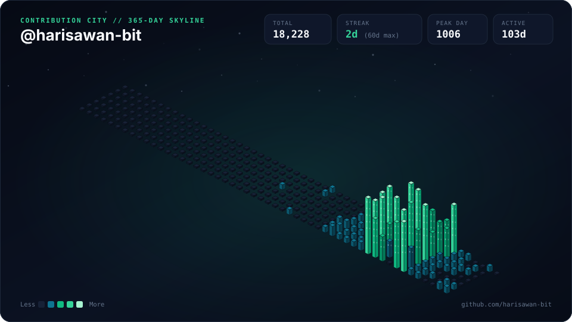
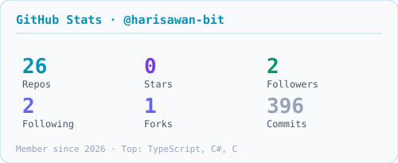
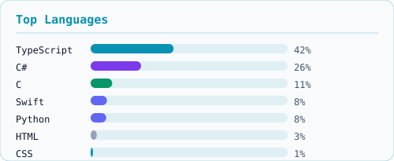

<picture>
  <source media="(prefers-color-scheme: dark)" srcset="https://raw.githubusercontent.com/harisawan-bit/harisawan-bit/main/dark.svg">
  <source media="(prefers-color-scheme: light)" srcset="https://raw.githubusercontent.com/harisawan-bit/harisawan-bit/main/light.svg">
  
</picture>

# Muhammad Haris Awan

MBBS student and software developer based in Islamabad, Pakistan. I build autonomous agents, local LLM benchmarking tools, and end-to-end evidence-synthesis pipelines (PRISMA 2020 systematic review and meta-analysis tooling, from literature search to publication-ready figures).

## Featured Projects & Upstream Work

| Project | Focus | Stack / Scope | Status |
| :--- | :--- | :--- | :--- |
| **[poolr](https://github.com/harisawan-bit/poolr)** | No-code desktop SRMA suite — full PRISMA 2020 pipeline to publication-ready manuscript | `TypeScript` `React` `C#/.NET 8` `Rust/Tauri` | `v0.6.6` |
| **[loaf-fm](https://github.com/m-uvex/loaf-fm/pull/121)** | Fast Rust-based Material 3e file manager for Linux — keybindings, archive extraction, transfer speed/ETA, checksums & RAM optimizations | `Rust` | Merged (`#121`, `#124`, `#126`) |
| **[llvm-project](https://github.com/llvm/llvm-project/pull/221085)** | Compiler & toolchain infrastructure — `[libc]` emulated `float128` `totalorder` (`#221085`) & `LowerSwitch` branch weights (`#236527`) | `C++` `LLVM` | Merged (`#221085`) · Open (`#236527`) |
| **[Linux Kernel (`cx25840`)](https://github.com/harisawan-bit/harisawan-bit/tree/main/upstream-contributions)** | `drivers/media/i2c/cx25840`: return `-EOPNOTSUPP` instead of `WARN_ON` (found via `syzbot`) | `C` `Linux` | Accepted ([mainline](http://patchwork.linuxtv.org/project/linux-media/patch/CACaF87XKQbdLEHTCLFZh=TAt__dZzWf_d1vneKU9Lnx8kAHEiA@mail.gmail.com/)) |
| **[CPython](https://github.com/python/cpython/pull/160777)** | `gzip` partial recovery (`#160777`), IDLE smart-dedent (`#160776`), `email.utils.parseaddr` (`#160775`) | `Python` `C` | Open PRs |
| **[NumPy](https://github.com/numpy/numpy/pull/33152)** & **[Pandas](https://github.com/pandas-dev/pandas/pull/71302)** | `ma.testutils` scalar NaNs (`#33152`) · `Block.replace_list` perf (`#71302`) | `Python` | Open PRs |
| **[squidbrake](https://github.com/batrapulkit/squidbrake/pull/92)** & **[repowise](https://github.com/repowise-dev/repowise/pull/3576)** | Follow `make` includes & `ifeq` branches (`#92`) · URL handling on new conversation (`#3576`) | `Upstream` | Merged |
| **[sentinel-cyber-agent](https://github.com/harisawan-bit/sentinel-cyber-agent)** | Unified security orchestration agent wrapping `nuclei`, `subfinder`, `httpx`, `sherlock`, and `prowler` behind one plugin API | `C` | `v2.5.0` |

### More Projects

| Project | Description | Stack | Version |
| :--- | :--- | :--- | :--- |
| **[lecture-notes-compiler](https://github.com/harisawan-bit/lecture-notes-compiler)** | High-density lecture notes compiler and agentic skill across US Legal, Letter, and A4 formats with spatial QA | `Python` | - |
| **[evidence-synth](https://github.com/harisawan-bit/evidence-synth)** | Evidence synthesis framework: search, deduplication, AI screening, and DerSimonian-Laird random-effects meta-analysis | `Python` | `v0.2.0` |
| **[episteme](https://github.com/harisawan-bit/episteme)** | Reproducible, dependency-free SRMA engine: PubMed to SVG figures in one command | `Python` | `v0.2.0` |
| **[srma-gap](https://github.com/harisawan-bit/srma-gap)** | Pre-flight evidence-gap checker for systematic-review topics (PubMed + PROSPERO) | `Python` | `v1.0.0` |
| **[PocketOllama](https://github.com/harisawan-bit/PocketOllama)** | Local OpenAI & Ollama-compatible inference server for iOS using `llama.cpp` and Metal acceleration | `Swift` `Metal` | `v0.5` |

## Tech Stack

**Languages**

<picture>
  <source media="(prefers-color-scheme: dark)" srcset="https://raw.githubusercontent.com/harisawan-bit/harisawan-bit/main/assets/tech-languages-dark.svg">
  <source media="(prefers-color-scheme: light)" srcset="https://raw.githubusercontent.com/harisawan-bit/harisawan-bit/main/assets/tech-languages-light.svg">
  
</picture>

  

**Frameworks & Libraries**

<picture>
  <source media="(prefers-color-scheme: dark)" srcset="https://raw.githubusercontent.com/harisawan-bit/harisawan-bit/main/assets/tech-frameworks-dark.svg">
  <source media="(prefers-color-scheme: light)" srcset="https://raw.githubusercontent.com/harisawan-bit/harisawan-bit/main/assets/tech-frameworks-light.svg">
  
</picture>

  

**Infrastructure & Tools**

<picture>
  <source media="(prefers-color-scheme: dark)" srcset="https://raw.githubusercontent.com/harisawan-bit/harisawan-bit/main/assets/tech-infra-dark.svg">
  <source media="(prefers-color-scheme: light)" srcset="https://raw.githubusercontent.com/harisawan-bit/harisawan-bit/main/assets/tech-infra-light.svg">
  
</picture>

Currently exploring: Agentic RAG, Distributed Systems, CUDA, and Clinical NLP.

## GitHub Activity

<picture>
  <source media="(prefers-color-scheme: dark)" srcset="https://streak-stats.demolab.com/?user=harisawan-bit&hide_border=true&background=0A101F&stroke=22D3EE&ring=A78BFA&fire=10B981&currStreakLabel=22D3EE&sideLabels=94A3B8&currStreakNum=F8FAFC&sideNums=F8FAFC&dates=64748B&titleColor=22D3EE&card_width=1180" />
  
</picture>

 

<picture>
  <source media="(prefers-color-scheme: dark)" srcset="https://raw.githubusercontent.com/harisawan-bit/harisawan-bit/output/stats-dark.svg" />
  
</picture>
<picture>
  <source media="(prefers-color-scheme: dark)" srcset="https://raw.githubusercontent.com/harisawan-bit/harisawan-bit/output/toplangs-dark.svg" />
  
</picture>

 

<picture>
  <source media="(prefers-color-scheme: dark)" srcset="https://raw.githubusercontent.com/harisawan-bit/harisawan-bit/output/snake-dark.svg" />
  <source media="(prefers-color-scheme: light)" srcset="https://raw.githubusercontent.com/harisawan-bit/harisawan-bit/output/snake-light.svg" />
  
</picture>

## Links

- [LinkedIn](https://www.linkedin.com/in/muhammad-haris-awan-b8884b190/)
- [ORCID](https://orcid.org/0009-0009-0192-337X)
- [Email](mailto:an25mbbs026.student@fui.edu.pk)
- [Mehvar](https://mehvar.store/)
- [Instagram](https://instagram.com/harisawan._)
