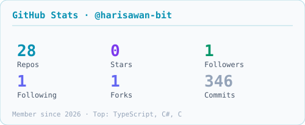
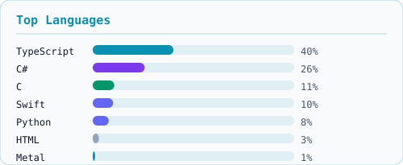

# Muhammad Haris Awan

MBBS student and software developer based in Islamabad, Pakistan. I build autonomous agents, local LLM benchmarking tools, and end-to-end evidence-synthesis pipelines (PRISMA 2020 systematic review and meta-analysis tooling, from literature search to publication-ready figures).

## Projects

| Project | Description | Stack | Version |
| :--- | :--- | :--- | :--- |
| **[poolr](https://github.com/harisawan-bit/poolr)** | No-code desktop SRMA suite: full PRISMA 2020 pipeline to publication-ready manuscript | TypeScript, React, C#/.NET 8, Rust/Tauri | `v0.6.3` |
| **[evidence-synth](https://github.com/harisawan-bit/evidence-synth)** | Evidence synthesis framework: search, deduplication, AI screening, and DerSimonian-Laird random-effects meta-analysis | Python | `v0.2.0` |
| **[episteme](https://github.com/harisawan-bit/episteme)** | Reproducible, dependency-free SRMA engine: PubMed to SVG figures in one command | Python | `v0.2.0` |
| **[srma-gap](https://github.com/harisawan-bit/srma-gap)** | Pre-flight evidence-gap checker for systematic-review topics (PubMed + PROSPERO) | Python | `v1.0.0` |
| **[PocketOllama](https://github.com/harisawan-bit/PocketOllama)** | Local OpenAI & Ollama-compatible inference server for iOS using llama.cpp and Metal acceleration | Swift, Metal | `v0.5` |
| **[sentinel-cyber-agent](https://github.com/harisawan-bit/sentinel-cyber-agent)** | Unified security orchestration agent wrapping nuclei, subfinder, httpx, sherlock, and prowler behind one plugin API | C | `v2.5.0` |
| **[ollama-benchmark-cli](https://github.com/harisawan-bit/ollama-benchmark-cli)** | CLI instrumentation for local LLM performance benchmarking | Python | `v1.0.0` |
| **[rankforge-seo-agent](https://github.com/harisawan-bit/rankforge-seo-agent)** | Automated SEO / GEO / AEO workflow for coding agents | PowerShell | `v1.0.0` |
| **[sha1-cracker-ios](https://github.com/harisawan-bit/sha1-cracker-ios)** | GPU-accelerated SHA-1 suffix search for iOS with heterogeneous Metal + CPU ARM64 engines and checkpoint resume | Swift, Metal | `v1.2.0` |

## Upstream Contributions

- **Linux Kernel (`drivers/media/i2c/cx25840`)**: `media: cx25840: return -EOPNOTSUPP instead of WARN_ON in cx25840_init` — [linux-media #158059](http://patchwork.linuxtv.org/project/linux-media/patch/CACaF87XKQbdLEHTCLFZh=TAt__dZzWf_d1vneKU9Lnx8kAHEiA@mail.gmail.com/) (Accepted, queued for mainline; found via [syzbot](https://syzkaller.appspotmail.com/bug?extid=9123948aef13fe92d706)). More details in [upstream-contributions](https://github.com/harisawan-bit/harisawan-bit/tree/main/upstream-contributions).

## Tech Stack

**Languages**

<picture>
  <source media="(prefers-color-scheme: dark)" srcset="https://raw.githubusercontent.com/harisawan-bit/harisawan-bit/main/assets/tech-languages-dark.svg">
  <source media="(prefers-color-scheme: light)" srcset="https://raw.githubusercontent.com/harisawan-bit/harisawan-bit/main/assets/tech-languages-light.svg">
  
</picture>

  

**Frameworks & Libraries**

<picture>
  <source media="(prefers-color-scheme: dark)" srcset="https://raw.githubusercontent.com/harisawan-bit/harisawan-bit/main/assets/tech-frameworks-dark.svg">
  <source media="(prefers-color-scheme: light)" srcset="https://raw.githubusercontent.com/harisawan-bit/harisawan-bit/main/assets/tech-frameworks-light.svg">
  
</picture>

  

**Infrastructure & Tools**

<picture>
  <source media="(prefers-color-scheme: dark)" srcset="https://raw.githubusercontent.com/harisawan-bit/harisawan-bit/main/assets/tech-infra-dark.svg">
  <source media="(prefers-color-scheme: light)" srcset="https://raw.githubusercontent.com/harisawan-bit/harisawan-bit/main/assets/tech-infra-light.svg">
  
</picture>

Currently exploring: Agentic RAG, Distributed Systems, CUDA, and Clinical NLP.

## GitHub Activity

<picture>
  <source media="(prefers-color-scheme: dark)" srcset="https://streak-stats.demolab.com/?user=harisawan-bit&hide_border=true&background=0A101F&stroke=22D3EE&ring=A78BFA&fire=10B981&currStreakLabel=22D3EE&sideLabels=94A3B8&currStreakNum=F8FAFC&sideNums=F8FAFC&dates=64748B&titleColor=22D3EE&card_width=1180" />
  
</picture>

 

<picture>
  <source media="(prefers-color-scheme: dark)" srcset="https://raw.githubusercontent.com/harisawan-bit/harisawan-bit/output/stats-dark.svg" />
  
</picture>
<picture>
  <source media="(prefers-color-scheme: dark)" srcset="https://raw.githubusercontent.com/harisawan-bit/harisawan-bit/output/toplangs-dark.svg" />
  
</picture>

 

<picture>
  <source media="(prefers-color-scheme: dark)" srcset="https://raw.githubusercontent.com/harisawan-bit/harisawan-bit/output/snake-dark.svg" />
  <source media="(prefers-color-scheme: light)" srcset="https://raw.githubusercontent.com/harisawan-bit/harisawan-bit/output/snake-light.svg" />
  
</picture>

## Links

- [LinkedIn](https://www.linkedin.com/in/muhammad-haris-awan-b8884b190/)
- [ORCID](https://orcid.org/0009-0009-0192-337X)
- [Email](mailto:an25mbbs026.student@fui.edu.pk)
- [Mehvar](https://mehvar.store/)
- [Instagram](https://instagram.com/harisawan._)
